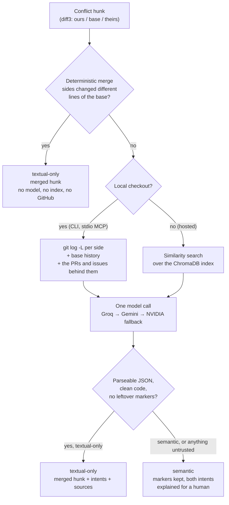
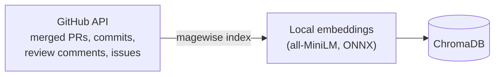
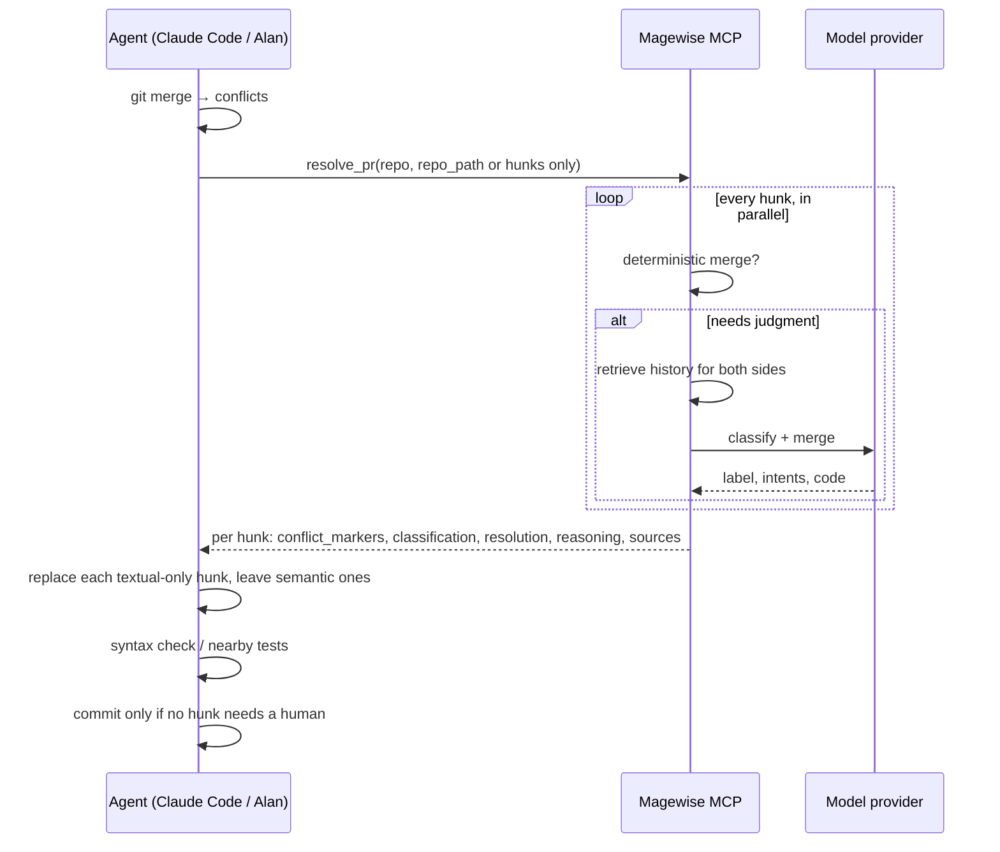

# Magewise

**Intent-aware merge conflict resolution for coding agents.**

Git merges text. It has no idea *why* two branches changed the same lines, so every conflict sends someone digging through PRs, commits and issues to reconstruct intent. Agents now open PRs faster than humans can do that.

Magewise does the digging. For each conflict hunk it retrieves the history behind both sides (PR descriptions, commit messages, review comments, linked issues), works out what each side was trying to do, and then either:

- **textual-only**: both sides changed independent things → returns a merged hunk that keeps both, or
- **semantic**: both sides changed the same behavior differently → returns no merge, only both intents, so a human decides.

It never writes to your repo by itself, and anything it can't trust (unparseable model output, leftover markers) is treated as *semantic*.

Before any of that, a **deterministic line-level merge** settles about 3 in 10 real conflicts for free (no model, no index, no GitHub), matching the maintainer 93% of the time.

Ships as an **MCP server** (stdio or streamable HTTP), a **CLI**, a **REST API**, and an **agent skill** for Claude Code and Alan.

## Results

Replayed against **40 real conflict hunks from 20 merge commits** in [pallets/flask](https://github.com/pallets/flask)'s history, scored against what the maintainer actually committed. Same 40 hunks, four sources of history:

| | Git, with base history (default with a checkout) | Git, since merge base only | Similarity search (hosted) | No history |
|---|---|---|---|---|
| Resolved automatically | 29 / 40 (72%) | 29 / 40 (72%) | 23 / 40 (58%) | 28 / 40 (70%) |
| Identical to the maintainer | 21 | 22 | 18 | 20 |
| Resolved but different | 8 | 7 | 5 | 8 |
| Precision (identical / resolved) | 72% | 76% | 78% | 71% |
| Deferred to a human | 11 | 11 | 17 | 12 |

Baselines on the same hunks: always take "ours" 15%, always take "theirs" 12%. The maintainer had to combine both sides in 29 of 40 (73%), which is why picking a side rarely works.

What this shows, and doesn't:

- **Magewise beats picking a side by a wide margin in every mode**: 45–55% of all hunks resolved identically to the maintainer, against 12–15% for either baseline. Most of that is there even without history, so it comes from the model reading the conflict with its common ancestor (diff3 markers).
- **The differences between modes are within run-to-run noise.** The two git columns differ only in a few added commit messages, yet 10 of the 40 hunks changed outcome between them, in both directions (wrong → deferred, match → deferred, deferred → wrong). The model's own variance is as large as the gaps between columns, so this eval doesn't show that any history source beats another.
- What history clearly does is make the reasoning explain itself: the git lookup surfaces the real commits behind each side (e.g. one side of a merge was "Reformat with black"), which a reviewer can check.
- "Resolved but different" includes formatting-only differences (quote style, trailing commas) and real errors (6 in each git mode). That is why the CLI can gate resolutions on your tests (`--test`) and the MCP skill tells agents to run tests before committing.

**Model comparison** (same 40 hunks, git history with base history):

| | Resolved automatically | Identical to the maintainer | Resolved but different | Deferred | Speed per call |
|---|---|---|---|---|---|
| Groq `gpt-oss-120b` (default) | 19 | 14 (74% of resolved) | 5 | 21 | 1-5 s |
| NVIDIA Nemotron | 29 | 21 (72%) | 6 | 11 | 8-140 s |

Precision is about the same (74% vs 72%); Groq hands more hunks to a human instead of guessing, and it is much faster. Both get the demo conflicts right. Per-hunk table: [groq](eval/results-git-groq.md).

**Deterministic resolution (no model, no history)** runs before any of the above. Git reports a conflict whenever the two sides' edits merely touch; a line-level three-way merge inside the hunk keeps both when they changed different lines of the common ancestor, and defers when a line one side added was also added or removed by the other (a move or a duplicate).

| | Hunks | Resolved without a model | Identical to the maintainer |
|---|---|---|---|
| Flask + Jinja merge history (every scorable hunk) | 250 | 73 (29%) | 68 (93% of resolved) |
| The 40-hunk eval above | 40 | 17 | 17 (Groq got 12 of those 17, Nemotron 16) |

On the 40-hunk eval, putting it in front of Groq raises identical-to-maintainer from 14 to 19 and cuts model calls from 40 to 23. In front of Nemotron: 21 to 22, also 23 calls. These hunks never touch the index, GitHub or a model API.

Matching is whitespace-insensitive, otherwise exact. The 40 hunks are all the scorable ones found walking Flask's merges newest-first, not a hand-picked set. History is limited to what existed before each merge. The base-history run also added one prompt line explaining base-history entries.

Per-hunk tables: [git](eval/results-git.md), [git since merge base](eval/results-git-shallow.md), [similarity](eval/results-semantic.md), [none](eval/results-none.md).

## Install

```bash
pip install git+https://github.com/pranjal269/mage-wise    # or, from a clone: pip install -e .
```

Set `GITHUB_TOKEN` (read access) and at least one model key: `GROQ_API_KEY` (console.groq.com), `NVIDIA_API_KEY` (build.nvidia.com) or `TOGETHER_API_KEY`. All serve open-weights models through OpenAI-compatible APIs. `GEMINI_API_KEY` (aistudio.google.com) adds Google's `gemini-3-flash-preview`, a proprietary model. Default fallback order: Groq, Gemini, NVIDIA, Together. With several keys, Magewise falls back to the next provider when one errors, times out or rate-limits; `LLM_PROVIDERS=groq,nvidia` sets the order, and any other OpenAI-compatible endpoint works via `LLM_BASE_URL`, `LLM_API_KEY` and `LLM_MODEL`. See [.env.example](.env.example).

Index a repo's history once (a few minutes for 300 PRs):

```bash
magewise index pallets/flask
```

Use diff3 conflict markers so Magewise can see the common ancestor; it is far more accurate with them:

```bash
git config merge.conflictstyle diff3
```

## Use it

### MCP server (agents)

Local (stdio):

```json
{
  "mcpServers": {
    "magewise": {
      "command": "magewise-mcp",
      "env": { "GITHUB_TOKEN": "...", "GROQ_API_KEY": "...", "NVIDIA_API_KEY": "..." }
    }
  }
}
```

**Claude Code:** this repo ships a project-scoped [.mcp.json](.mcp.json). After `pip install`, open the repo in `claude` with `GITHUB_TOKEN` and `GROQ_API_KEY` (or `NVIDIA_API_KEY`) set in your shell, approve the `magewise` server when prompted, and the tools are available.

Hosted (streamable HTTP at `/mcp`, bearer-token auth required on any non-local interface):

```bash
MAGEWISE_TOKEN=<secret> magewise-mcp --http --host 0.0.0.0 --port 8000
# or: docker build -t magewise . && docker run -p 8000:8000 -v magewise-data:/data \
#       -e MAGEWISE_TOKEN=... -e GITHUB_TOKEN=... -e GROQ_API_KEY=... -e NVIDIA_API_KEY=... magewise
```

Connect clients to `https://<host>/mcp` with header `Authorization: Bearer <secret>`.

Tools:

| Tool | Does |
|---|---|
| `index_repo(repo, since?, limit?)` | Index a GitHub repo's merged PRs, review comments and issues. |
| `resolve_pr(repo, files or repo_path, pr_number?)` | Resolve **every** hunk in every conflicted file in one call, in parallel. Returns each file's new `content` (resolved hunks applied, the rest keep their markers) plus per-hunk results. |
| `resolve_conflict(repo, file_path, conflict_markers, pr_number?, repo_path?)` | Classify one hunk; return `classification`, `resolution` (or `null`), `reasoning`, `sources`, `model`. |

Calls take seconds (deterministic hunks are instant) to a couple of minutes; the server sends progress notifications every 10s so clients don't time out.

### CLI (humans)

After a merge stops on conflicts:

```bash
magewise resolve                                # dry run: shows what it would do for every hunk
magewise resolve --write                        # writes textual-only resolutions; semantic hunks keep their markers
magewise resolve --write --test "pytest -q"     # keeps the resolutions only if the tests pass
magewise resolve --test "pytest -q"             # preview: apply, test, always roll back
```

With `--test`, a failing run rolls every file back to its conflict markers, so you never end up with a merge that breaks the build (`--keep-on-fail` keeps it for inspection). Exits 1 if any hunk still needs a human or the tests failed.

### REST API

```bash
uvicorn magewise.main:app
curl -X POST localhost:8000/resolve-pr -H "Content-Type: application/json" \
  -d '{"repo": "pallets/flask", "files": {"src/flask/app.py": "<file content with conflict markers>"}}'
curl -X POST localhost:8000/resolve -H "Content-Type: application/json" \
  -d '{"repo": "pallets/flask", "file_path": "src/flask/app.py", "conflict_markers": "<<<<<<< HEAD\n..."}'
```

### Agent skill (Claude Code, Alan)

[skills/magewise-resolve-conflict/SKILL.md](skills/magewise-resolve-conflict/SKILL.md) tells an agent when to call Magewise and how to act on the answer: one `resolve_pr` call, apply only `textual-only` hunks as small edits, never hand-merge a `semantic` one, keep verification proportional, don't commit while markers remain. It needs the MCP server above to be connected.

**Claude Code:** copy the skill into your skills folder, then start `claude` in the repo with the merge in progress. The skill loads automatically when a merge leaves conflict markers, or on `/magewise-resolve-conflict`.

```bash
# for one project (run in that project; commit .claude/ to share it with the team)
mkdir -p .claude/skills && cp -r /path/to/mage-wise/skills/magewise-resolve-conflict .claude/skills/
# or for every project on this machine
mkdir -p ~/.claude/skills && cp -r /path/to/mage-wise/skills/magewise-resolve-conflict ~/.claude/skills/
```

```bash
claude mcp add magewise -- magewise-mcp      # or use this repo's .mcp.json
git merge feature-branch                     # stops on conflicts
claude "resolve the merge conflicts"         # the skill calls resolve_pr, applies the safe hunks, reports the rest
```

On Windows (cmd): `xcopy /E /I path\to\mage-wise\skills\magewise-resolve-conflict .claude\skills\magewise-resolve-conflict`.

**Alan:** import the skill via **Skills → Import → From GitHub** with this repo's URL, and add the MCP server under **Settings → Plugins → MCP → Add custom connector** (URL `https://<host>/mcp`, header `Authorization: Bearer ${API_KEY}`, then enter your `MAGEWISE_TOKEN` when connecting).

## How it works

Each conflict hunk goes through the cheapest step that can settle it:



The index is built once per repo, ahead of time:



A whole merge from an agent's side: one call, then small edits.



- **Retrieval**, with a local checkout (CLI, stdio MCP with `repo_path`): `git log -L` finds the commits since the merge base that touched exactly each side's lines, plus the older commits that made the base version of those lines what it was (why the code looked that way before either side changed it), then the PRs that merged them ("Merge pull request #N" or "(#N)") and the issues those link to. Without a checkout (hosted): similarity search over the index, preferring documents that touched the conflicted file.
- **Free deterministic path** ([`resolver.deterministic`](magewise/resolver.py)): needs diff3 markers. Both sides identical → take it once. One side unchanged from the base → take the other. Otherwise diff each side against the base inside the hunk; if their edits touch different base lines and no line is added by one side and added or removed by the other, apply both. All comparisons are exact, so a whitespace-only change (e.g. a deleted blank line) is never dropped. Resolves about 3 in 10 real conflict hunks at 93% precision with no model, index or GitHub call.
- **Model**: OpenAI-compatible APIs behind one function in [magewise/llm.py](magewise/llm.py). Default order: Groq `gpt-oss-120b` (answers in seconds), then Gemini `gemini-3-flash-preview` (proprietary; only if `GEMINI_API_KEY` is set), then NVIDIA Nemotron, each taking over when the previous one errors or rate-limits (Groq's free tier allows about 8,000 tokens a minute, i.e. 1-2 hunks a minute). `LLM_PROVIDERS=groq,nvidia` keeps it to open-weights models. The response reports which model answered.
- **Safety default**: anything ambiguous is classified *semantic*. Magewise proposes, the caller applies and tests.

## Evaluation

[eval/harness.py](eval/harness.py) replays real merge conflicts from a repo's history:

1. Walk the repo's merge commits (newest first) whose parents conflict in a `.py` file.
2. Recreate each conflict from the merge's two parents with diff3 markers.
3. Resolve every hunk with history limited to documents created **before** the merge (no leakage).
4. Compare to the hunk the maintainer actually committed; also report "always take ours/theirs" baselines.

```bash
git clone https://github.com/pallets/flask /tmp/flask
python eval/harness.py /tmp/flask --repo pallets/flask --max-hunks 40
python eval/harness.py /tmp/flask --repo pallets/flask --max-hunks 40 --history git-shallow   # no base history
python eval/harness.py /tmp/flask --repo pallets/flask --max-hunks 40 --history semantic   # similarity search only
python eval/harness.py /tmp/flask --repo pallets/flask --max-hunks 40 --history none       # ablation
```

## Development

```bash
pip install -e ".[dev]"
pytest -q tests
```

## License

[MIT](LICENSE)

## Limitations

- Hosted mode has no checkout, so it attributes history to each side by similarity, which is much weaker than the git-based lookup.
- The index holds a repo's most recent PRs (300 by default); older conflicts get commit messages but not their PR discussion.
- MCP: Magewise returns resolved content; the calling agent writes it and runs the tests. CLI: `--test` rolls back the whole run on failure; it doesn't yet isolate which hunk broke the tests.
- A hosted (HTTP) server refuses `repo_path`, so a remote caller can't make it read repos on the server's own disk; hosted callers send `files` instead and get similarity-search history rather than git history.
- Latency depends on the provider: Groq answers in seconds but its free tier rate-limits after 1-2 hunks a minute (the fallback takes over); Gemini's preview model can return 503 under high demand; NVIDIA's hosted Nemotron varies from seconds to ~2 minutes per call.
- The deterministic merge works line by line: two edits to the same line always go to the model, and it can't see that a change on one side breaks code the other side added nearby (the tests can).
